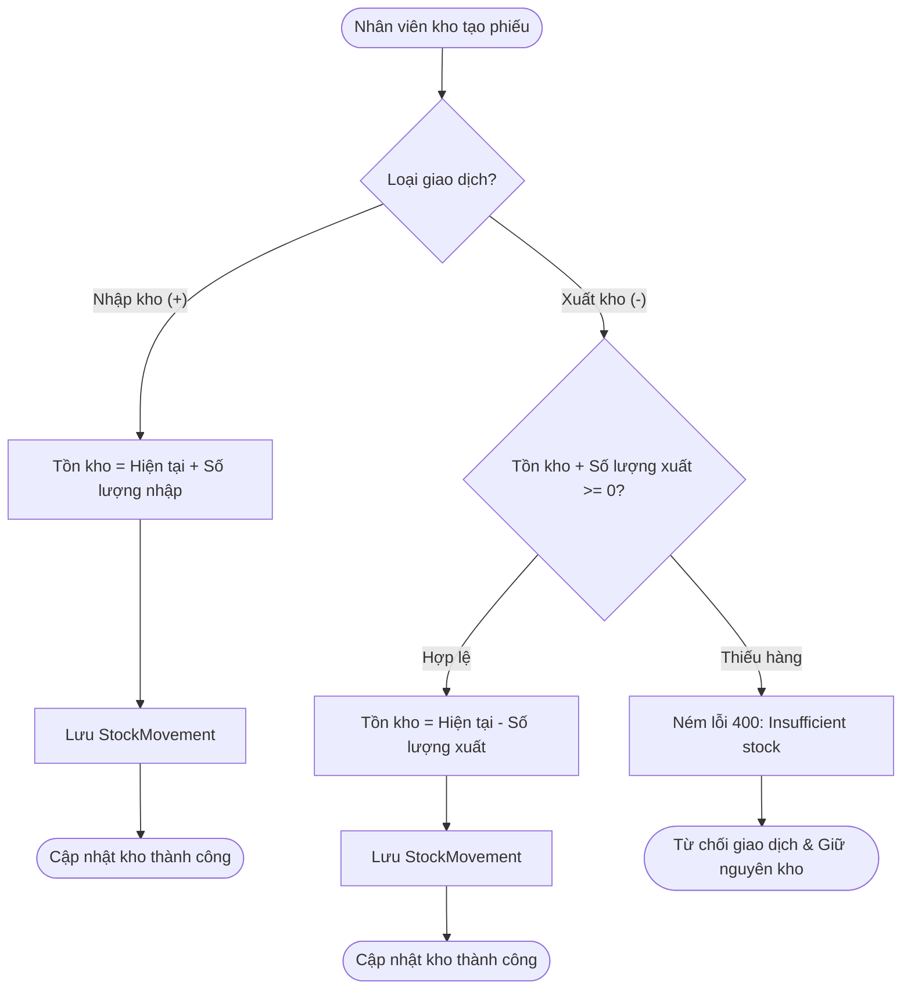

# TÀI LIỆU NGHIỆP VỤ & KỊCH BẢN THUYẾT TRÌNH DEMO
## HỆ THỐNG QUẢN LÝ TỒN KHO & NHÀ CUNG CẤP (ISMS)
*(Inventory & Supplier Management System)*

---

## MỤC LỤC
1. [Giới Thiệu Tổng Quan Dự Án](#1-giới-thiệu-tổng-quan-dự-án)
2. [Kiến Trúc & Công Nghệ Sử Dụng](#2-kiến-trúc--công-nghệ-sử-dụng)
3. [Mô Hình Dữ Liệu & Quy Tắc Nghiệp Vụ Cốt Lõi](#3-mô-hình-dữ-liệu--quy-tắc-nghiệp-vụ-cốt-lõi)
4. [Kịch Bản Thuyết Trình Demo Từng Bước (Speaking Script)](#4-kịch-bản-thuyết-trình-demo-từng-bước-speaking-script)
5. [Bộ Câu Hỏi Phản Biện Thường Gặp (Q&A Defense)](#5-bộ-câu-hỏi-phản-biện-thường-gặp-qa-defense)

---

## 1. Giới Thiệu Tổng Quan Dự Án

### 1.1. Bối cảnh & Vấn đề giải quyết
Trong quản trị chuỗi cung ứng vừa và nhỏ, việc theo dõi hàng tồn kho bằng Excel hoặc ghi chép thủ công thường gặp các vấn đề nghiêm trọng:
- **Lệch số liệu tồn kho**: Cho phép xuất bán âm, không rõ ai đã sửa số lượng.
- **Rách dữ liệu kiểm toán**: Khi lỡ tay xóa sản phẩm hoặc xóa đơn nhập, toàn bộ lịch sử biến động trong quá khứ bị biến mất.
- **Rủi ro rò rỉ dữ liệu**: Nhân viên kho có thể can thiệp vào tài khoản quản trị, hoặc xem sửa đổi trái phép.

### 1.2. Mục tiêu của hệ thống ISMS
ISMS giải quyết triệt để các vấn đề trên với 4 trụ cột nghiệp vụ:
1. **Kiểm toán kho tuyệt đối (Audit Trail)**: Số lượng tồn kho không được sửa tay trực tiếp; mọi thay đổi tăng/giảm bắt buộc sinh phiếu `StockMovement`.
2. **Bảo vệ toàn vẹn dữ liệu (Chống xuất âm & Xóa mềm Soft Delete)**: Không cho phép tồn kho âm dưới bất kỳ hình thức nào; mọi thao tác xóa đều bảo toàn lịch sử.
3. **Phân quyền chặt chẽ (Role-Based Access Control - RBAC)**: Phân tách rõ quyền giữa `ADMIN`, `STAFF` và `USER`.
4. **Cảnh báo thông minh**: Tự động phát hiện và cảnh báo mặt hàng sắp hết định mức (Low Stock Alert < 10 sản phẩm).

---

## 2. Kiến Trúc & Công Nghệ Sử Dụng

- **Backend Framework**: Spring Boot 3.4.3 / Java 17 LTS.
- **Persistence Layer**: Spring Data JPA / Hibernate 6.x.
- **Database**: Microsoft SQL Server.
- **Frontend Layer**: Thymeleaf Template Engine + Bootstrap 5.3 + JavaScript Vanilla (Fetch API).
- **Security & Password Hashing**: PBKDF2WithHmacSHA256 (Salt 16 bytes, 65.536 iterations).
- **API Documentation**: OpenAPI / Swagger UI 3.0.

---

## 3. Mô Hình Dữ Liệu & Quy Tắc Nghiệp Vụ Cốt Lõi

### 3.1. Sơ đồ luồng nghiệp vụ Xuất / Nhập kho

### 3.2. Ba quy tắc nghiệp vụ quan trọng nhất (Cần nhấn mạnh khi demo)

| Quy tắc | Bản chất kỹ thuật | Giá trị thực tế |
| :--- | :--- | :--- |
| **1. Stock Integrity (Toàn vẹn kho)** | Số lượng `quantity_in_stock` không có API sửa trực tiếp. Tạo mới sản phẩm luôn bắt đầu bằng `0`. Tồn kho = Tổng đại số lịch sử `StockMovement`. | Ngăn chặn gian lận số liệu kho của thủ kho. |
| **2. Insufficient Stock Guard** | Chặn xuất âm ở tầng Service và Database constraint. | Đảm bảo hệ thống phản ánh đúng thực tế hàng hóa vật lý. |
| **3. Soft Delete & Audit Safety** | Sử dụng `@SQLDelete` và `@SQLRestriction("is_deleted = 0")`. Cột `is_deleted BIT`. | Dù người dùng xóa sản phẩm, đối tác hay phiếu kho, bản ghi gốc vẫn còn trong DB để phục vụ thanh tra, kiểm toán. |

---

## 4. Kịch Bản Thuyết Trình Demo Từng Bước (Speaking Script)

> **Gợi ý thời lượng demo**: 5 – 7 phút. Hãy mở sẵn trình duyệt (Web App) và một tab Postman dự phòng.

---

### PHẦN 1: MỞ ĐẦU (30 giây)
> 🎤 **Lời nói mẫu:**
> *"Kính thưa Thầy/Cô và các bạn, hôm nay em xin đại diện nhóm trình bày về dự án **ISMS - Hệ thống Quản trị Tồn kho và Nhà cung cấp**. Điểm đặc biệt của hệ thống này là được thiết kế theo đúng chuẩn ERP doanh nghiệp, đảm bảo tính toàn vẹn tồn kho tuyệt đối, phân quyền 3 cấp độ và áp dụng cơ chế Xóa mềm (Soft Delete) giúp bảo toàn dữ liệu kiểm toán."*

---

### PHẦN 2: DEMO PHÂN QUYỀN RBAC (1 phút)
1. **Thao tác**:
   - Đăng nhập bằng tài khoản: `staff / staff123`.
2. 🎤 **Lời nói mẫu:**
   > *"Đầu tiên, em đăng nhập với vai trò **STAFF** (Nhân viên kho). Ở vai trò này, nhân viên có quyền quản lý sản phẩm, đối tác và thực hiện nghiệp vụ kho. Tuy nhiên, Thầy/Cô có thể thấy trên thanh Menu hoàn toàn **không xuất hiện mục Quản lý người dùng (User Management)**."*
3. **Thao tác**:
   - Đăng xuất và đăng nhập lại bằng `admin / admin123`.
4. 🎤 **Lời nói mẫu:**
   > *"Bây giờ em chuyển sang tài khoản **ADMIN**. Lúc này menu User Management xuất hiện. Admin có thể tra cứu toàn bộ danh sách tài khoản, nâng quyền nhân viên lên STAFF hoặc hạ xuống USER. Hệ thống có cơ chế bảo vệ đặc biệt: **Không cho phép Admin tự xóa chính mình** và **Không cho phép giáng chức Admin duy nhất còn lại** nhằm tránh tê liệt hệ thống."*

---

### PHẦN 3: DEMO QUẢN LÝ SẢN PHẨM & CẢNH BÁO TỒN KHO THẤP (1 phút)
1. **Thao tác**:
   - Mở trang **Dashboard**.
   - Chỉ vào ô thống kê **Low Stock Alert** (Cảnh báo hàng sắp hết).
2. 🎤 **Lời nói mẫu:**
   > *"Tại trang Tổng quan (Dashboard), hệ thống tự động quét và cảnh báo các sản phẩm có số lượng tồn kho **dưới 10 đơn vị**. Ví dụ ở đây chuột không dây chỉ còn 8 cái, USB Hub chỉ còn 5 cái, được bôi màu cam cảnh báo để nhân viên kịp thời đặt hàng từ đối tác."*
3. **Thao tác**:
   - Vào trang **Products**, bấm **Add Product**.
   - Nhập tên: `Màn hình Dell UltraSharp 27"`.
   - Chọn Nhà cung cấp: `TechLink Distribution`.
   - Bấm **Save**.
4. 🎤 **Lời nói mẫu:**
   > *"Khi thêm mới sản phẩm, Thầy/Cô có thể thấy em không hề có ô để nhập số lượng tồn kho ban đầu. Số lượng mặc định luôn là **0**. Bởi vì về mặt nghiệp vụ, hàng muốn có trong kho bắt buộc phải có chứng từ phiếu Nhập kho!"*

---

### PHẦN 4: DEMO XUẤT NHẬP KHO & CHỐNG XUẤT ÂM (2 phút - Trọng tâm nhất ⭐)
1. **Thao tác 1 - Nhập kho**:
   - Vào mục **Stock Movements** -> Bấm **Record Stock Movement**.
   - Chọn sản phẩm vừa tạo: `Màn hình Dell UltraSharp 27"`.
   - Nhập số lượng: `50` (Dương: Nhập kho).
   - Bấm lưu -> Quay lại trang **Products**, số lượng đã tự động cập nhật lên **50**.
2. 🎤 **Lời nói mẫu:**
   > *"Em vừa thực hiện phiếu Nhập kho 50 chiếc màn hình. Lịch sử đã ghi nhận người thực hiện, thời gian chi tiết, và tồn kho sản phẩm tự động nhảy lên đúng 50 chiếc."*
3. **Thao tác 2 - Thử nghiệm Xuất kho quá số lượng (Negative Test)**:
   - Quay lại **Stock Movements** -> Bấm **Record Stock Movement**.
   - Chọn màn hình Dell, nhập số lượng xuất: `-60` (Kho chỉ có 50).
   - Bấm lưu.
4. 🎤 **Lời nói mẫu:**
   > *"Bây giờ em thử xuất 60 chiếc, tức là vượt quá 50 chiếc hiện có. Hệ thống lập tức chặn lại và cảnh báo lỗi rõ ràng: **'Insufficient stock in warehouse! Hiện chỉ có 50 đơn vị, không thể xuất 60 đơn vị'**. Cơ chế Insufficient Stock Guard này đảm bảo kho hàng không bao giờ bị âm số liệu."*
5. **Thao tác 3 - Xuất kho hợp lệ**:
   - Nhập số lượng xuất: `-10`.
   - Hệ thống chấp nhận, tồn kho giảm chính xác về **40**.

---

### PHẦN 5: DEMO TÍNH NĂNG XÓA MỀM & TOÀN VẸN DỮ LIỆU (1.5 phút ⭐)
1. **Thao tác**:
   - Vào trang **Suppliers**, thử xóa nhà cung cấp `TechLink Distribution` (đang có sản phẩm màn hình).
   - Hệ thống báo lỗi: *"Không thể xóa nhà cung cấp vì đang có sản phẩm liên kết!"*.
2. 🎤 **Lời nói mẫu:**
   > *"Về mặt bảo vệ dữ liệu, hệ thống không cho phép xóa nhà cung cấp đang có hàng trong kho. Ngoài ra, đối với các đối tác hoặc sản phẩm không còn kinh doanh, nhóm em đã áp dụng giải pháp **Xóa mềm (Soft Delete)** thông qua annotation `@SQLDelete` và `@SQLRestriction('is_deleted = 0')` của Hibernate 6."*
3. 🎤 **Lời giải thích kỹ thuật:**
   > *"Khi người dùng bấm Xóa, hệ thống chỉ cập nhật cờ `is_deleted = 1`. Trên giao diện người dùng, sản phẩm sẽ biến mất. Tuy nhiên, trong database SQL Server, bản ghi và toàn bộ lịch sử xuất nhập kho trong quá khứ vẫn được giữ nguyên 100%, phục vụ việc truy xuất kế toán và kiểm toán khi cần."*

---

### PHẦN 6: KẾT LUẬN (30 giây)
> 🎤 **Lời nói mẫu:**
> *"Tóm lại, hệ thống ISMS không chỉ đáp ứng đầy đủ các chức năng quản lý danh mục và giao dịch kho, mà còn được hoàn thiện về mặt kiến trúc: bảo mật mật khẩu PBKDF2, bắt lỗi tập trung bằng GlobalExceptionHandler, ngăn chặn tấn công SQL Injection và lỗi tràn dữ liệu. Nhóm em xin chân thành cảm ơn Thầy/Cô đã lắng nghe và rất mong nhận được câu hỏi góp ý ạ!"*

---

## 5. Bộ Câu Hỏi Phản Biện Thường Gặp (Q&A Defense)

#### ❓ Câu hỏi 1: "Tại sao không dùng Spring Security mà lại viết Session tay?"
> **Trả lời:**
> *"Dạ thưa Thầy/Cô, việc tự xây dựng xác thực bằng HttpSession và Controller Filter giúp nhóm làm chủ hoàn toàn luồng dữ liệu (Data Flow), hiểu sâu về cách quản lý phiên, cookie `JSESSIONID`, cơ chế băm mật khẩu chuẩn PBKDF2WithHmacSHA256 với Salt 16 bytes và 65.536 vòng băm, đồng thời dễ dàng tùy biến phản hồi JSON theo chuẩn `ApiResponse` đồng nhất cho cả Web lẫn REST API."*

#### ❓ Câu hỏi 2: "Cơ chế Xóa mềm (Soft Delete) hoạt động như thế nào trong code?"
> **Trả lời:**
> *"Dạ, nhóm em tích hợp `@SQLDelete` ngay trên Entity. Ví dụ với Product: `@SQLDelete(sql = 'UPDATE products SET is_deleted = 1 WHERE product_id = ?')`. Khi gọi `productRepository.delete(product)`, Hibernate sẽ chặn lệnh `DELETE FROM` vật lý và thay bằng lệnh `UPDATE`. Đồng thời với `@SQLRestriction('is_deleted = 0')`, mọi câu truy vấn `findAll()`, tìm kiếm hay thống kê đều tự động gắn thêm điều kiện lọc, giúp code Service rất gọn mà không cần viết điều kiện `WHERE is_deleted = 0` thủ công ở từng query."*

#### ❓ Câu hỏi 3: "Nếu nhân viên xóa nhầm phiếu Nhập kho thì sao?"
> **Trả lời:**
> *"Dạ, hệ thống có cơ chế Hoàn tác tự động (`Reversion`). Khi xóa một phiếu kho, hệ thống sẽ lấy tồn kho hiện tại trừ đi lượng đã thay đổi của phiếu đó. Tuy nhiên, nếu lượng hàng của phiếu đó đã bị xuất bán hết dẫn đến việc hoàn tác làm âm kho (`revertedStock < 0`), hệ thống sẽ ném ngoại lệ chặn xóa ngay lập tức để bảo vệ số liệu kho không bị rách."*
